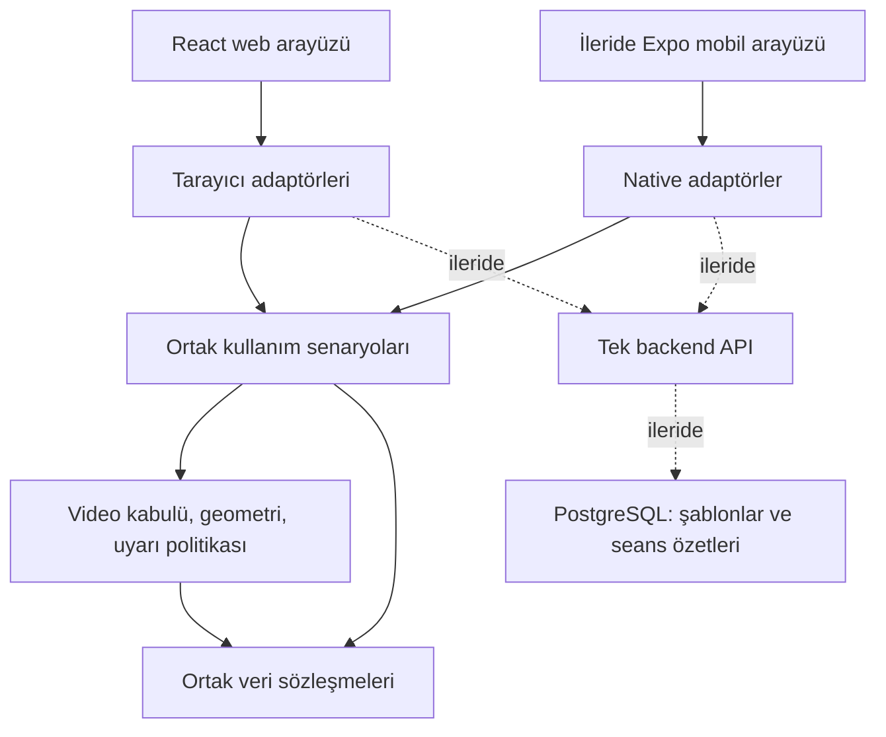
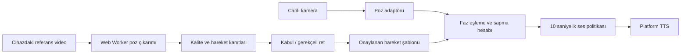

# Mimari

## Yaklaşım

Npm workspaces monorepo içinde Clean Architecture yönünde bağımlılıklar. Web ilk platformdur. Mobil daha sonra Expo/React Native olarak eklenir; arayüz, kamera, dosya erişimi ve ses adaptörleri platforma özeldir. İş kuralları, veri tipleri ve kullanım senaryoları TypeScript paketlerinde paylaşılır. Web arayüzünün otomatik olarak native uygulamaya dönüşeceği varsayılmaz.

Backend başlangıçta tek dağıtılan uygulamadır. Bağımsız ölçekleme ihtiyacı ortaya çıkarsa referans işleme veya raporlama ayrı servise ayrılabilir. Şu anda veri işleyen backend modülü ve mesaj kuyruğu yoktur; Kubernetes/RabbitMQ gibi ek işletim yükleri eklenmez.

## Sorumluluklar

| Konum | Sorumluluk | İçermemeli |
|---|---|---|
| `packages/contracts` | Serileştirilebilir veri tipleri | React, File, HTMLVideoElement, SDK sınıfları |
| `packages/core` | Deterministik kurallar, hesaplamalar | Ağ, DOM, veritabanı, TTS, sistem saati |
| `packages/application` | Portlar ve kullanım senaryoları | Framework veya cihaz API çağrıları |
| `apps/web/src/adapters` | Dosya, tarayıcı TTS, canlı kamera ve Worker | Kopyalanmış iş kuralları |
| `apps/mobile` | Native sürücü portları ve adaptör iskeletleri; Expo istemcisi sonraki iş | Web DOM bağımlılıkları |
| `services/api` | HTTP sınırı ve ileride senkronizasyon | Kamera karelerini zorunlu buluta taşıma |

Çekirdek ayrıca DOM ve Node tipleri olmadan derlenir. SDK çıktısı adaptörde ortak tiplere dönüştürülür. Geometri aynı ölçekli koordinat gerektirir; normalize x/y verileri görüntü en/boy oranı düzeltilmeden doğrudan açı hesabına sokulmaz.

## Hedef analiz akışı

Referans Worker'ı, poz/açı dizisi ve 10 Hz örnekleme kodlandı. `ExtractReferenceMap` varsayılan serbest hareket veya seçili squat ön ayarına göre kabul/ret kararı üretir. `genericCycles.ts` sabit kamera izdüşümünde pelvis merkezli 2B eklem yolundan başlangıca dönen döngüyü bulup 51 örnekli şablon çıkarır; `squatCycles.ts` özel iniş/dip/çıkış denetimini korur. Canlı serbest hareket karşılaştırıcısı aynı şablonun gidiş/dönüş fazına, ayrı squat karşılaştırıcısı açı/faza bakar. Referans dosya zaman sırasıyla örneklenir; aynı anda yalnızca bir kare Worker'a gönderilir. Klasik Worker, SDK'nın `importScripts` tabanlı WASM yükleyicisiyle uyum için kullanılır. SDK, WASM ve model aynı origin'den yüklenir. Gerçek cihaz doğrulaması sürer.

Vücut profili: `LivePoseSource`, `BodyProfileRepository` portları ve `CalibrateBody` kullanım senaryosu `application` içindedir. `BodyCalibration`, pelvis merkezli 2B normalizasyon, kayıt doğrulama ve kurulum ses zamanlaması `core` içindedir; DOM/SDK/sistem saati kullanmaz. Profil bir kez oluşturulur ve video/tekrar/görünümden bağımsızdır. `BrowserBodyProfileRepository` webde seçilmiş sayısal alanları localStorage'a yazar; mobil aynı porta native depolama bağlayabilir. `BrowserCameraPose` izin, monoton saat, görüntü ve kaynak temizliğini yönetir. Referans çıkarıcıyla aynı `PoseWorkerClient` üzerinden model çalıştırır. Tarama tamamlanınca kamera kapanır. Mobil aynı kullanım senaryosuna native kamera portu bağlayabilir. Referans kamera izdüşümü yardımcı fonksiyonu ayrı kalır. Ayrıntılar `CALIBRATION.md` içinde.

Canlı karşılaştırma referansın aynı saniyesini beklemez; şablon indeksini sınırlı ve ileri giden bir aralıkta eşler. Tekrarın dönüşü, başlangıç duruşuna yakın ölçülen kare ve faz ilerlemesiyle sayılır. Görünmeyen eklemler veya tutarsız kamera açısı `unknown` olur; egzersiz tekniği veya 3B anatomi değerlendirilmez. Daha geniş hareket sınıflarında sınırları değerlendirmek gerekir.

## Oturum raporu ve saklama

`TrackLiveSquatSession` saf ölçüm sonuçlarından kapsam/sapma sayaçlarını toplar; bitiş zamanı web adaptöründen monoton saatle verilir. `personalBody.ts` geçerli kayıtlı profilin bacak/gövde oranıyla, her karede yeniden bulunan kalça merkezinden kişisel birimlere geçer; açı hesabı aynı 2B geometriyi korur. Anatomik açı ofseti veya kişisel derinlik sınırı üretmez.

`TrackLiveGenericSession` de aynı `LivePoseSource`/`SpeechOutput` portlarını ve `FeedbackPolicy`yi kullanır. Başlangıç duruşu ölçülene kadar kurulum zamanı uyarı saatine girmez. `LiveGenericComparer`, referans ve canlı eklemleri gövde ölçeğinde hizalar; referans bacağı ölçülebiliyorsa kayıtlı profilin bacak/gövde oranını iki tarafta aynı birime uygular. Üst gövdeyle sınırlı referansta profil uygulanmış gibi gösterilmez. Genel oturum özeti ekran ve Geçmiş'tedir; kayıt yalnız toplu sayaç/süre içerir.

`SessionRecord` ayırt edilebilir veri sözleşmesi eski squat v1 ile genel döngü v2 kayıtlarını aynı listede tutar. `SessionHistoryRepository` uygulama portu ve `sessionRecord.ts` doğrulama/serileştirme/alan seçimi çekirdektedir. `BrowserSessionHistoryRepository` ve `NativeSessionHistoryRepository` tarih/kimlik/depolama etkilerini üstlenir. Web iki rapor türünü kendi ölçüm kapsamıyla gösterir. Native adaptör aynı sürücü/anahtar için paylaşılan işlem sırasıyla asenkron okuma-yazma yarışını önler. Bulut servisi gerekmez.

`SavedReferenceTemplate`, `ReferenceTemplateRepository` ve `referenceLibrary.ts` iki şablon türünü de aynı kitaplıkta tutar. Web/native şablon adaptörleri yalnızca doğrulanmış sayısal alanları saklar; profil veya ham video sözleşmeye girmez. Webde `BrowserReferenceVideoRepository` özgün `File` nesnesini şablon kimliğiyle ayrı IndexedDB deposunda tutar. `saveExerciseCollection` şablon ve video kaydını tek kullanıcı eylemi olarak sıralar; video yazılamazsa şablonu geri alır ve başarısızlığı gösterir. Silme iki depoya uygulanır. Native video depolaması bu web adaptöründen bağımsız tasarlanacaktır. Ortak doğrulama sürüm, faz/zaman tutarlılığı, izlenen eklemler, 51 örnek ve kitaplık sınırını denetler; dışarıdan gelen kabul bayrağını gerçek analiz kanıtına dönüştürmez. Ürün davranışı `PRODUCT.md` içindedir.

Native oturum denetleyicisi yeni kamera kaynağı factory'si kullanır; `PrepareLiveSessionSource` ve `TrackLiveSquatSession` ile webdeki hazırlık/rapor kurallarını paylaşır. Profil, geçmiş portu ve kamera ile aynı monoton saat dışarıdan verilir. Gecikmiş callback'ler nesil kimliğiyle elenir; rapor dondurulup tek kez saklanır, başarısızlıkta tekrar deneme/açıkça vazgeçme mümkündür. Expo ekranları, AppState, kurulum sesi, native poz motoru ve gerçek cihaz bağlantıları henüz yoktur.

## Web çalışma alanı

Web bölümleri hash URL üzerinden `AppSection` ile yönetilir; gezinme ve demo kapısı ortak hareket çekirdeğine taşınmaz. `BrowserDemoSession` yalnızca sekmedeki demo giriş bayrağını saklar; kimlik/yetki kontrolü veya bulut hesabı değildir. Mevcut profil/şablon/geçmiş anahtarları değiştirilmedi. `BodyProfileDetails` saklanan sayısal oranları şematik gösterir; yeni 3B/anatomik ölçüm üretmez. `AppProps` ile test depolaması ve tarama sürücüleri enjekte edilebilir; üretimde tarayıcı adaptörleri kullanılır.

Kamera kapatma her kaynak için ayrı denenir; SDK iptal hatası video bağlantısını/track temizliğini atlamaz. Tarama ekranı kapatma hatasını yakalayıp sonuç/kayıt akışını sürdürür. Teknik hata bildirimi asıl hatayı korur; pencere temizliği odak ve `inert` kilidini geri bırakır.

Kamera cihaz kimliği, dikey çekim tercihi ve `MediaStreamTrack` zoom sınırları web adaptörlerinde kalır. `cameraLens.ts` gerçek yetenek/ayar okumalarını ve kısıt uygulamasını yönetir; `CameraLensControls` eski track'e ait sonuçları nesil kimliğiyle eler. `BrowserCameraPose` seçili cihaz ve ideal boyutları yakalama isteğine aktarır; işleme çözünürlüğü sınırı ayrı kalır. Ortak geometri, profil, kabul ve ses kuralları bu arayüz değişikliğinden etkilenmez.

`BrowserPoseExtractor` sabit bitmap alındıktan sonra sıradaki kareye seek yaparken Worker mevcut bitmap'i işler. Aynı anda bir inference isteği vardır; her kare sırası/zamanı korunur, bekleyen seek iptali yakalanır. Dengeli/Ayrıntılı çözünürlük tercihi web adaptöründe kalır.

`voiceCommand.ts` yalnızca tamamlanmış komut metnini saf eyleme çevirir. Web `BrowserVoiceCommands` izinle başlayan tanıma, yeniden bağlanma sınırı, eski sonuç eleme ve iptali yönetir; ses/metin depolamaz. UI eylemleri mevcut bitirme ve ses kapatma akışlarına bağlanır. `SpeechOutput` portu değişmedi; mevcut `TrackLiveSquatSession` artık düzelmiş hata için bekleyen sesi iptal eder ve geç başlangıç makbuzunu rapora yazmaz. Native ses tanıma sürücüsü henüz yoktur.

## Sabit duruş yolu

`StaticPoseTemplate` ve `StaticSessionSummary` ortak sözleşmelerdir. `staticPose.ts` kararlı aralıkları ve duruşun sayısal temsilini çıkarır; `liveStatic.ts` yön eşleme, güvenilir süre biriktirme ve referans çizimi koordinatlarını hesaplar. İkisi de DOM/saat/depolama içermez. `TrackStaticSession` kamera portu, ortak ses politikası ve özet üretimini bağlar; hedefte kaynağı kapatır. `StaticSessionArchive` tek oturumun sabit özetini, eşzamanlı yazma kilidini, yeniden kaydetmeyi ve açık vazgeçmeyi yönetir; depolama etkisi verilen portta kalır. Webde `StaticPoseResults` aralık seçimini, `StaticLiveExercisePanel` kamera ve süre hedefini yönetir. Şablonlar mevcut kitaplıkta, v3 süre raporları mevcut geçmiş deposunda tutulur; web ve native adaptörler aynı runtime doğrulamayı kullanır. Yeni servis veya bulut video aktarımı eklenmedi. Native UI bağlantısı ayrıca yapılacaktır.

## Hatalar ve yaşam döngüsü

- `accepted/rejected` yalnızca tamamlanmış analiz sonucudur. `unavailable/failed` teknik durumdur.
- İstek iptali, yeni video seçimi ve component unmount eski sonucu geçersiz kılmalı.
- Kamera açıkken ayrılmada track'leri durdur, Worker'ı kapat, object URL'leri bırak, TTS'yi iptal et.
- Kamera izinleri kullanıcı eylemiyle istenir; web kamera için localhost veya HTTPS kullanılır.
- Sunucuya gelecek JSON ileride runtime şemayla doğrulanmalı; TypeScript tek başına HTTP girdi doğrulaması değildir.
- Kullanıcı verisi kabul eden endpoint eklenmeden kimlik doğrulama, yetkilendirme ve kaynak sınırları uygulanmalı.

## Kaynaklar

- [Expo monorepo desteği](https://docs.expo.dev/guides/monorepos/)
- [MediaPipe Web poz algılama](https://developers.google.com/edge/mediapipe/solutions/vision/pose_landmarker/web_js)
